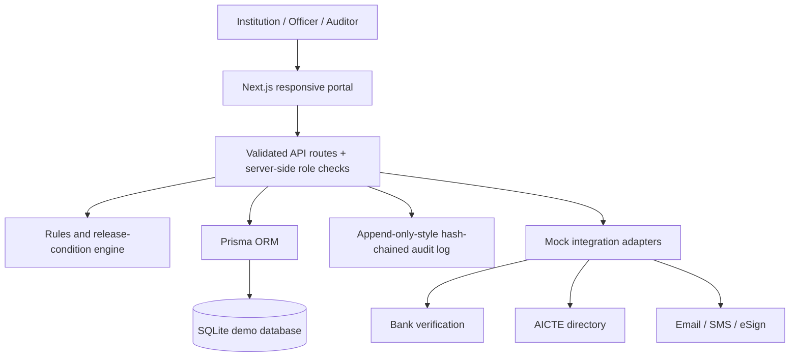

# FDR-Track — SIH26265

A demo-ready FDR / security deposit lifecycle management portal prototype for the AICTE Regulation Bureau. This is **not an official AICTE service**. All institutions, users, instruments, banks, amounts and events are synthetic.

## Run locally (Node.js 20+)

1. Install Node.js 20 or newer.
2. Install PostgreSQL locally or use a hosted PostgreSQL service such as Neon / Supabase / Vercel Postgres.
3. Copy `.env.example` to `.env` and replace the sample `DATABASE_URL` with your PostgreSQL connection string.
4. Install packages: `npm install`
5. Prepare database and demo records: `npx prisma db push && npm run db:seed`
6. Start: `npm run dev` and open http://localhost:3000

The seeded demo password is `Demo@12345` but this prototype's role switcher is a demonstration convenience; it is **not production authentication**. Switch role in the top-right selector. Seeded accounts: Institution Demo, Scrutiny Officer, Competent Authority, Read-only Auditor and System Admin. The initial admin session is selected automatically.

## Vercel deployment

This project is now configured for hosted PostgreSQL deployments. For Vercel, add these environment variables in the project settings:

- `DATABASE_URL` — a PostgreSQL connection URL
- `SESSION_SECRET` — a secure random string
- `DOCUMENT_ENCRYPTION_KEY` — a secure 32-byte value or equivalent key material

Recommended deployment setup:

- Use Vercel Postgres, Neon, Supabase Postgres, or another hosted PostgreSQL service
- Keep the app code on GitHub and deploy from Vercel
- Run `npx prisma db push` and `npm run db:seed` once after the first deployment or via a Vercel build step if needed

The app remains a demo/prototype and is not meant for real production use without additional authentication, encryption, monitoring, and security review.

## What's implemented

- Central repository, search and admin-status filtering; institution-scoped visibility for institution users.
- Separate date-derived validity and workflow status fields.
- Role-checked server routes for instrument creation, review actions and release decisions.
- Configurable-rule-shaped rules engine with R01, R02, R08, R09 and R11 starter checks; visible discrepancy records.
- Trust source tags (`INSTITUTION_DECLARED`, `DOCUMENT_EXTRACTED`, `BANK_CONFIRMED`) and a mock bank-verification adapter.
- Release workflow guardrails; approval is not automatic and final decision is restricted to Competent Authority / Admin.
- Audit log with SHA-256 hash chaining and a verification endpoint.
- Seeded synthetic records and users; dashboard KPIs; test cases for core rule/date/reminder/release logic.
- Responsive neutral government-portal-style UI and integration status page.

## Real vs simulated

| Capability | Prototype status |
|---|---|
| Institution directory | Synthetic local seed data; real AICTE integration not connected |
| Bank verification | Mock outcome only; not a real bank check |
| OCR / document extraction | Schema and adapter-facing fields are present; upload/OCR UI is not yet wired |
| Email and SMS reminders | Not sent; scheduler/outbox integration remains to be connected |
| Date simulation | UI demonstrates intent only; it does not alter server clock in this build |
| FDR document encryption/storage | Schema has encrypted-storage path and hash fields; secure upload/storage pipeline is not yet implemented |
| Renewal lineage | Database relations and sample lineage seeded; guided renewal-link UI not yet wired |
| PDF/CSV reports | Not implemented in this build |
| Impact measurements | Current counts shown; baseline entry is illustrative and not yet persisted/calculated |
| Authentication | Demo role switcher; production login, hardened sessions, MFA and rate limiting required |
| Audit chain | SHA-256 hash chaining and verification endpoint; database administrators could still alter all records, so this is tamper-evident, not immutable |

## Architecture

## Assumptions and safety

- Required amount and tenure are **illustrative seed values only**. Confirm current AICTE Approval Process Handbook and applicable rules before any real deployment.
- Government institution exemptions are represented in the data model but the end-to-end exemption rule is not yet wired.
- OCR findings should be treated as leads for scrutiny, never as definitive fraud conclusions.
- No release is automatically approved.
- Never upload genuine financial documents or use real personal data in this demo.
- Use PostgreSQL, secure cookies, hardened authentication, encrypted object storage, key management, observability, rate limiting, CSRF protections and security review before production.

## Tests

Run `npm test`. Core rules tests cover date validity, rule findings, reminder offsets and release conditions.

## Known limitations

This is an initial full-stack prototype, not a finished regulated production system. The remaining high-priority work is document upload + actual encryption and OCR, persisted simulated clock/scheduler and reminder outbox, full configurable rules UI, discrepancy response flow, complete lineage creation UI, CSV/PDF exports, persistent impact baselines, comprehensive e2e tests, and production-grade authentication/security. The UI intentionally labels integrations as simulated rather than implying external verification.
